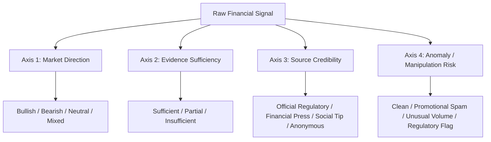

# DAKOTA — RESEARCH PLAN & EMPIRICAL EVALUATION SPECIFICATION

**Document Version**: 1.0.0 (Research Readiness Edition)  
**Date**: October 19, 2026  
**Status**: ACTIVE RESEARCH PROGRAM  
**Target Architecture**: Project Dakota Intelligence Engine (Social Evidence Intake, JEV / Qwen3.5-9B, Classical Baselines, Provenance Verification)  
**Authors**: Dakota AI Research & Financial Reliability Engineering Group  

---

## 1. Research Question & Primary Hypotheses

### Primary Research Question
> *To what extent can foundation causal language models (such as Qwen3.5-9B) augmented with official Just-Enough-Validation (JEV) constraint protocols accurately distinguish genuine, verifiable financial-market events from promotional Telegram stock-pumping chatter, and how do they compare against classical lexical and discriminative baselines?*

### Formal Hypotheses
- **H1 (Abstention over Hallucination)**: Constrained JEV models will exhibit significantly lower hallucination rates than unconstrained language models when evaluated on uncorroborated promotional claims, correctly classifying them into `Insufficient Evidence`.
- **H2 (Lexical Baseline Competitiveness)**: Due to pronounced vocabulary distribution shifts between promotional spam (e.g., "rocket call", "urgent target", "guaranteed profit") and official financial filings (e.g., "SEBI", "quarterly earnings", "board meeting"), classical n-gram classifiers (TF-IDF + Logistic Regression) will provide strong classification accuracy at orders-of-magnitude lower computational cost.
- **H3 (Separation of Sufficiency and Direction)**: Conflating directional sentiment (`Bullish`, `Bearish`, `Neutral`, `Mixed`) with epistemic uncertainty (`Ambiguous`, `Insufficient Evidence`) degrades evaluation calibration. A multi-axis evaluation schema improves interpretability and decision utility for forensic investigators.

---

## 2. Dataset Origins, Scope & Sampling Limitations

### Provenance Audit
- **Collection Source**: Dakota live Telegram ingestion pipeline (`data/live/investigations.jsonl`) captured on **October 8, 2026**.
- **Monitored Channels**: Public financial prediction channels including `@markemahakelpredictions` (76.8%), `@Growx_intraday_groww` (11.0%), and related entities.
- **Curated Cohort**: 82 stable records indexed from `ANN-LIVE-001` through `ANN-LIVE-082`.
- **Duplicate Cluster Topology**: 60 unique event/content clusters. 46 singletons and 14 multi-record clusters covering 36 records.

### Sampling Limitations (Academic Honesty)
1. **Convenience Sample**: The 82 records represent a targeted slice of high-activity Telegram tip channels on a single trading day. It is **not** a representative random sample of the entire Indian capital market (NSE/BSE).
2. **Missing Long-Form Message Bodies**: Ingested messages were parsed into structured claims (`Source | Entity | Target | Type`) by earlier intake code, with 25 records classified as non-financial negative controls.
3. **External Corroboration Sparsity**: Only 30 of the 82 records have external news/filing links attached. 52 records are isolated social tips, reflecting the real-world operational challenge of verifying unregulated social-media claims.

---

## 3. Annotation Methodology & Canonical 6-Class Taxonomy

Dakota evaluates financial evidence against 6 canonical mutually exclusive classes:

1. **Bullish**: Verifiable positive operations, earnings growth, institutional accumulation, or supported technical breakouts corroborated by independent filings or credible news.
2. **Bearish**: Verifiable operational deterioration, regulatory penalties, SEBI investigations, accounting red flags, or confirmed technical breakdowns.
3. **Neutral**: Routine corporate disclosures (board meeting schedules, registrar updates) and macroeconomic releases without directional market implications.
4. **Mixed**: Material, verified evidence pointing in conflicting directions (e.g., strong revenue growth offset by simultaneous regulatory fines).
5. **Ambiguous**: Credible but undecidable claims with equal evidentiary weight (e.g., diametrically opposed institutional analyst ratings).
6. **Insufficient Evidence**: Uncorroborated promotional claims, speculative trading tips, social-media spam, or records lacking adequate factual proof.

### Strict Ground-Truth Invariant
- **Separation of Roles**: AI suggestions (`ai_suggested_label`) are strictly isolated from human review (`human_reviewed_label`). AI suggestions are never treated as ground truth without explicit human sign-off.
- **Review Prioritization**: Reviewers process a prioritized exception queue (`data/research/annotation_review_queue.csv`), focusing expert judgment on conflicting signals (Tier 1) and high-impact equity events (Tier 2), while routine uncorroborated tips (Tier 4) are batch-audited.

---

## 4. Multi-Axis Forensic Research Schema (Step Eight Architecture)

To resolve the limitation of forcing evidence sufficiency into a 1D sentiment label, future Dakota iterations evaluate across 4 orthogonal axes:



### Forensic Distinctions
- **Promotional Tip ≠ Proven Manipulation**: A suspicious message or price target is an indicator of risk, not legal proof of market abuse under SEBI (Prohibition of Fraudulent and Unfair Trade Practices) Regulations.
- **Missing Evidence ≠ False Claim**: An uncorroborated claim must be categorized as `Insufficient Evidence`, not labeled `Bearish` or `False`.

---

## 5. Experimental Baseline Configurations

| Baseline ID | Architecture | Feature / Model Details | Execution Environment |
| :--- | :--- | :--- | :--- |
| **Baseline A** | Majority-Class Predictor | Mode class prediction (`Insufficient Evidence`) | Python 3.14 (Local) |
| **Baseline B** | TF-IDF + Logistic Regression | Unigram + bigram sublinear TF-IDF (5,000 features), L2 regularization ($C=1.0$) | Scikit-learn 1.9.1 |
| **Baseline C** | TF-IDF + Classical ML | Complement Naive Bayes ($\alpha=1.0$) tuned for severe class imbalance | Scikit-learn 1.9.1 |
| **Baseline D** | Mock Classifier Control | Fixed heuristic logits across sentiment divergence tasks | Dakota Mock Adapter |
| **Baseline E** | Official Simple JEV + Qwen3.5-9B | Causal LM backbone quantized in 4-bit NF4 with branch logit extraction | WSL2 Ubuntu 22.04 + RTX 4060 GPU |

---

## 6. Leakage Prevention Protocol

All evaluation splits are generated at the **duplicate group level**, not the individual record level:
$$\text{Dev Groups} \cap \text{Held-Out Groups} = \emptyset$$
$$\text{Cross-Split Leakage} = 0$$

- Random seed is fixed at `42` with a 65% group ratio for development and 35% for held-out evaluation.
- Reference labels are strictly excluded from input prompts, ensuring no evaluation answers leak to the model.

---

## 7. Metrics, Uncertainty & Error Analysis

- **Primary Classification Metrics**: Accuracy, Balanced Accuracy, Macro Precision, Macro Recall, Macro F1.
- **Statistical Uncertainty**: 95% Wilson score confidence intervals computed for all accuracy estimates:
  $$w = \frac{p + \frac{z^2}{2n} \pm z \sqrt{\frac{p(1-p)}{n} + \frac{z^2}{4n^2}}}{1 + \frac{z^2}{n}}$$
- **Calibration Metrics**: Multi-Class Brier Score, Expected Calibration Error (ECE) across 10 confidence bins, Negative Log-Likelihood (NLL).
- **Error Analysis**: Tracking confusion between `Insufficient Evidence` and `Bullish` to detect model vulnerability to promotional hype.

---

## 8. Reproducibility Instructions

1. **Environment Setup**:
   ```bash
   # Windows Host (Baselines A-D)
   .\.venv\Scripts\python.exe scripts/prepare_research_dataset.py --all
   .\.venv\Scripts\python.exe scripts/run_research_baselines.py
   ```
2. **GPU JEV Execution (Baseline E)**:
   ```bash
   wsl -d Ubuntu-22.04 bash -c "cd '/mnt/d/dakota V4 with telegram integrated/dakota integ. d11 final prototype1 minus telegram feature/dakota' && /home/vdish/dakota-jev/.venv/bin/python scratch/wsl_jev_eval_worker.py"
   ```
